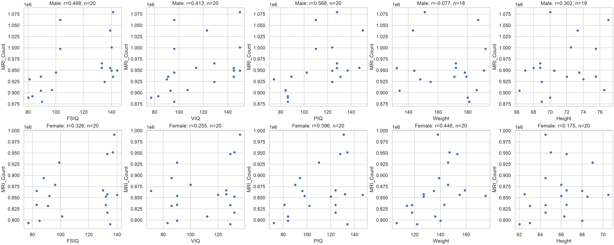
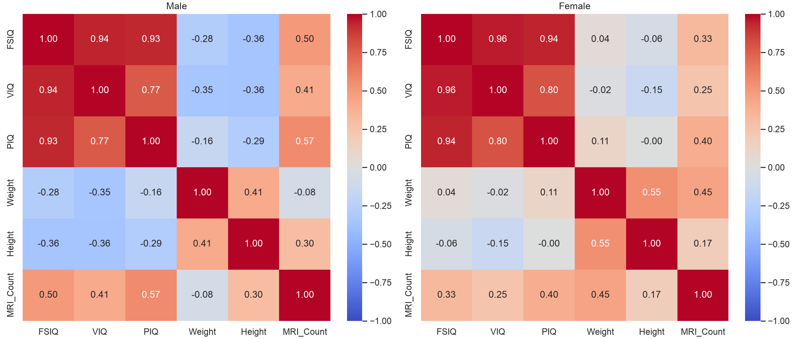

# Лабораторная работа №2

## Titanic

Данные загружены через `pd.read_csv`. В таблице 891 пассажир, из них 305 старше
30 лет. Возраст ровно 30 лет в эту группу не входит.

Пропуски есть в трёх столбцах: `Age` — 177, `Cabin` — 687, `Embarked` — 2.
В остальных столбцах пропусков нет. Для подсчёта использован `isna().sum()`.

Средний возраст и доля выживших рассчитаны через `groupby("Pclass")`:

| Класс | Средний возраст | Доля выживших |
| --- | ---: | ---: |
| 1 | 38,23 | 62,96% |
| 2 | 29,88 | 47,28% |
| 3 | 25,14 | 24,24% |

Пропуски возраста не заполнялись нулями: `mean()` исключает их из расчёта.
Доля выживших — среднее столбца `Survived`, где 1 означает выжившего, а 0 —
погибшего. В этой выборке у пассажиров первого класса доля выживших выше.
Само по себе это сравнение не устанавливает причины различий.

Пять наибольших тарифов: 512,3292; 512,3292; 512,3292; 263,0; 263,0.
Повторяющиеся значения сохранены, потому что нужны пять наибольших значений,
а не пять различных тарифов.

## Корреляционный анализ

Таблица `brainsize.txt` загружена с табуляцией в качестве разделителя и `NA`
в качестве обозначения пропуска. В выборке 20 мужчин и 20 женщин.

Корреляции Пирсона с `MRI_Count` рассчитаны отдельно для каждой группы:

| Признак | Мужчины | Женщины |
| --- | ---: | ---: |
| FSIQ | 0,498 | 0,326 |
| VIQ | 0,413 | 0,255 |
| PIQ | 0,568 | 0,396 |
| Weight | −0,077 | 0,446 |
| Height | 0,302 | 0,175 |

Максимальный модуль корреляции среди двух групп у `PIQ` для мужчин:
`r = 0,568`. Поэтому `strongest_mri_feature` равен `"PIQ"`.
Сам `MRI_Count` исключён из поиска, иначе его корреляция с собой дала бы 1.

Для каждой корреляции используются только строки, где известны оба значения.
Пропуск веса не исключает человека из расчёта связи IQ с `MRI_Count`.
Заполнение пропусков нулями исказило бы коэффициенты.

Коэффициент Пирсона показывает направление и силу линейной связи. Значения
около нуля означают слабую линейную связь, около 1 или −1 — сильную.
Отрицательный знак означает, что при увеличении одного признака второй
обычно уменьшается. Для сравнения силы используется модуль коэффициента.

### Диаграммы рассеяния



У мужчин положительная связь `PIQ` с `MRI_Count` заметнее, чем связь веса с
`MRI_Count`. Над каждым графиком указаны коэффициент и число доступных пар.

### Матрицы корреляций



Среди показателей IQ есть взаимные корреляции. Поэтому по этим таблицам нельзя
заключить, что каждый показатель независимо связан с `MRI_Count`.
В каждой группе всего 20 наблюдений; корреляция не доказывает причинность,
а различие коэффициентов между группами само по себе не доказывает
статистически значимого различия. Проверка значимости и причинный анализ
в этой работе не выполнялись.

## Запуск

Из каталога работы:

```sh
python -m pip install -r requirements.txt
python -m unittest -v test_lab2.py
python plot_correlations.py
```

Проверки охватывают исходные данные, пропуски возраста, границу 30 лет,
повторяющиеся тарифы, маленькую таблицу и выбор максимальной корреляции по
модулю. Коэффициенты для исходной таблицы также сверяются с `scipy.stats.pearsonr`.

Исходное задание и данные: [AKlimovUrfu/lab2](https://github.com/AKlimovUrfu/lab2).
